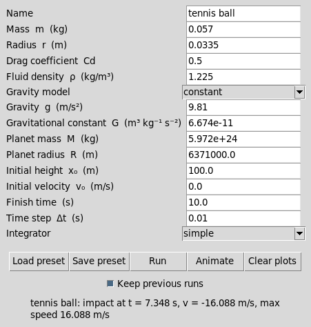
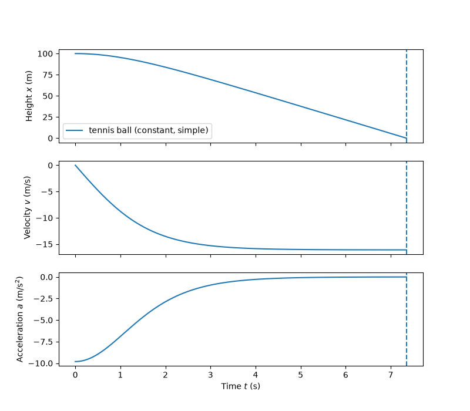
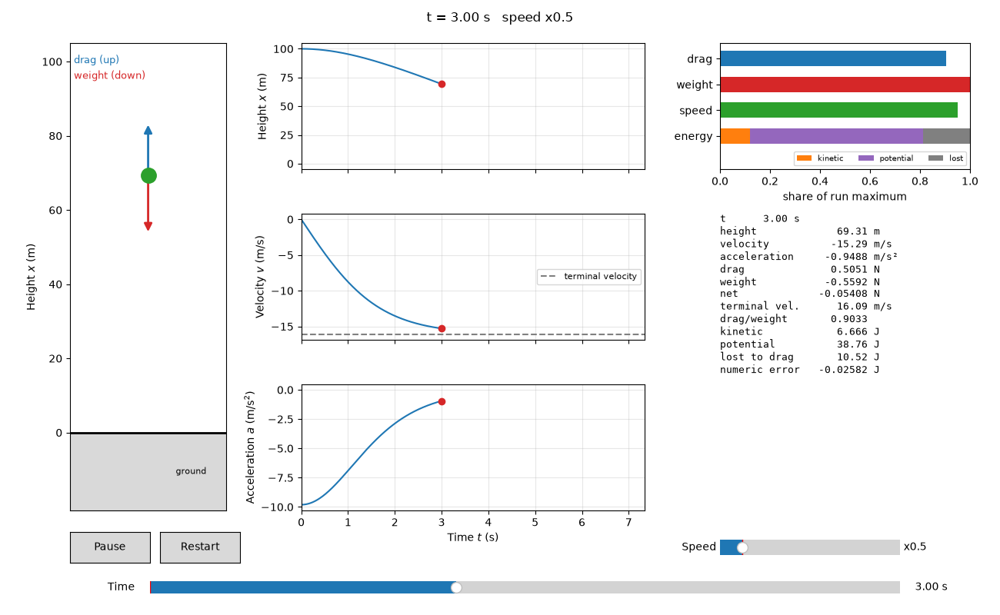

# Ball drop simulation

This program simulates a ball that falls in one dimension under gravity and quadratic drag. This is an extension of the challenge provided by TGR. Since you are here, I expect that you have finished reading the complete README.md in my submission folder, and were interested in how I could have extended this simulation or added features to it if I was provided with more time.

An optional animation in `extras/` replays a run with force arrows, live graphs, gauges and a readout.
Three sections near the end cover the problems with many users, the work I would do with more time, and the limitations.

It needs Python 3.10 or newer, numpy and matplotlib.





The tennis ball reaches its terminal velocity of 16.09 m/s and its acceleration falls to almost zero before it lands at 7.35 s.

`CONTEXT.md` defines the terms in this file (run, preset, trajectory and so on).

## Quick start

One command sets up a virtual environment, installs the requirements, runs the core tests and opens the GUI.

```
./start.sh          # Linux and macOS
start.bat           # Windows
python3 start.py    # any system (python start.py on Windows)
```

Options: `--no-gui` sets up and tests only. `--no-tests` skips the test run.

If `./start.sh` reports "permission denied", your unzip tool dropped the executable bit. Run `sh start.sh` or `python3 start.py` instead.

The script uses the interpreter inside `.venv` itself, so you do not need to activate the environment.
To work by hand later, activate it (`source .venv/bin/activate` on Linux and macOS, `.venv\Scripts\activate` on Windows) and run `python -m ballsim --gui`.

## What the brief asks and where it is met

Paths are relative to this folder. Test names are in `tests/` unless the path says otherwise.

| Brief requirement | Where in the code | Test that proves it |
|:--|:--|:--|
| Drag `\|FD\| = CD rho v^2 pi r^2`, opposite to motion | `ballsim/forces.py`, `QuadraticDrag` | `test_forces.py::test_drag_opposes_motion`, `test_simulation.py::test_terminal_velocity` |
| Constant gravity `FW = m g` | `forces.py`, `ConstantGravity` | `test_forces.py::test_constant_gravity`, `test_simulation.py::test_free_fall_matches_closed_form` |
| Newtonian gravity `-FW = G M m / (R + x)^2` | `forces.py`, `NewtonianGravity` | `test_forces.py::test_newtonian_at_ground`, `test_newtonian_falls_off_with_height`, `test_simulation.py::test_newtonian_matches_constant_for_huge_planet` |
| User picks the gravity model | `Parameters.gravity_model`, `make_forces` in `simulation.py`, GUI menu | `test_presets.py::test_shipped_presets_load`, `test_invalid_field_named[gravity_model-moon]` |
| `FW + FD = m a` | `simulation.py`, `acceleration` | `test_simulation.py::test_newtonian_acceleration_at_ground`, `extras/tests/test_quantities.py::test_net_is_drag_plus_weight` |
| Forces at time t from the current x and v, then numerical integration | `simulation.py`, `run` passes `accel(state)` to the integrator | `test_integrators.py::test_simple_step_matches_brief_formula` |
| The brief scheme, plus a built-in alternative | `ballsim/integrators.py`, `simple_step` and `rk4_step` | `test_simple_step_matches_brief_formula`, `test_rk4_exact_for_constant_acceleration`, `test_simulation.py::test_rk4_more_accurate_and_both_converge` |
| Calculate x, v and a | `Trajectory` in `simulation.py`, CSV columns `t,x,v,a`, three plot panels | `test_cli.py::test_cli_prints_summary_and_csv`, `test_simulation.py::test_free_fall_matches_closed_form` |
| User varies CD, rho, r, m, g, G, M, R, initial height and velocity, finish time, time step | `Parameters` and `validate` in `ballsim/parameters.py`, one preset key and one GUI entry each | `test_presets.py::test_invalid_field_named` (one case for each checked field except G and M), `test_newtonian_needs_positive_planet`, `test_simulation.py::test_upward_throw_still_impacts` |
| Model valid for x > 0, x = 0 is impact, R + x = 0 not handled | `run` stops at the first x <= 0 and interpolates to x = 0. `validate` requires a positive initial height and R | `test_simulation.py::test_impact_time_interpolated` |
| Tests and visualisations | `tests/`, `extras/tests/`, `ballsim/plotting.py`, `ballsim/gui.py`, `extras/animate.py` | 83 tests in total, `test_plotting.py::test_plot_smoke`, `extras/tests/test_animate.py` |
| Easy to extend, easy to change the input format | `Force` base class, `INTEGRATORS`, `make_forces`, `load_preset` | `test_integrators.py::test_names_match_parameters`, `test_presets.py::test_round_trip`, `test_unknown_key_rejected` |
| Instructions to compile, run and test | This file, `start.py` | `test_cli.py` (the start scripts have no automated test) |

No test checks a negative G or M. `validate` rejects them, but only in the Newtonian model.

## Scope

The core answers the brief: `ballsim/`, `tests/` and `presets/`.
`extras/` is an optional animation. I added it after the core was complete. Its only change to the core is the Animate button in `ballsim/gui.py`.
`start.py`, `start.sh` and `start.bat` are a convenience for setup.

Suggested reading order for the core:

1. `ballsim/parameters.py`: the inputs and their validation.
2. `ballsim/forces.py`: gravity and drag.
3. `ballsim/integrators.py`: the time-stepping schemes.
4. `ballsim/simulation.py`: the run loop and the trajectory.
5. Then `presets.py`, `plotting.py`, `__main__.py` (the command line) and `gui.py`.

## Physics

Height x points up. Velocity v points up. A falling ball has negative v.

Drag force, with no one-half factor because the brief defines the law this way:

```
|FD| = CD * rho * v^2 * pi * r^2
FD   = -CD * rho * pi * r^2 * v * |v|     (always opposes v)
```

Weight force, with constant gravity or with Newtonian gravity:

```
FW = -m * g
FW = -G * M * m / (R + x)^2
```

Newton's second law gives the acceleration:

```
FW + FD = m * a
```

The code adds the forces and divides by the mass.
Weight is always negative (downward). Drag has the opposite sign to v.
A falling ball has negative v, so drag points up and slows the fall.

The ground is at x = 0. In the Newtonian model it lies at distance R from the planet centre.

Integrators (set with the `integrator` key in a preset or with `--integrator`):

* `simple` is the scheme from the brief. It uses one acceleration a_{i-1} for both updates:

```
v_i = v_{i-1} + a_{i-1} * dt
x_i = x_{i-1} + v_{i-1} * dt + 0.5 * a_{i-1} * dt^2
```

* `rk4` is classic fourth-order Runge-Kutta. It is more accurate at larger time steps.

A run ends at the first step that takes the height to zero or below.
The program then interpolates linearly between the two samples to find the impact time and velocity.

## Install

You need Python 3.10 or later. Only the GUI needs Tk.

```
python -m venv .venv
source .venv/bin/activate
pip install -r requirements.txt
```

The `source` line is for Linux and macOS. On Windows, use `.venv\Scripts\activate` instead.
On Debian and Ubuntu, `python -m venv` can need the `python3-venv` package.

The dependencies are numpy, matplotlib and pytest. `requirements.txt` does not pin versions.

## Run

Run all commands from this folder, with the environment active.

```
python -m ballsim presets/tennis_ball.json
python -m ballsim presets/tennis_ball.json presets/satellite_reentry.json
python -m ballsim presets/tennis_ball.json --integrator rk4
python -m ballsim presets/tennis_ball.json --csv out.csv --no-plot
python -m ballsim presets/tennis_ball.json presets/satellite_reentry.json --csv out.csv --no-plot
```

Each command prints one summary line per run. For the two presets, the output is:

```
tennis ball: impact at t = 7.348 s, v = -16.088 m/s, max speed 16.088 m/s
satellite re-entry: impact at t = 144.732 s, v = -1386.184 m/s, max speed 1386.184 m/s
```

A plot window opens unless you give `--no-plot`.
With two presets, the plot window overlays both runs.

Options:

* `--integrator {simple,rk4}` replaces the integrator in every preset.
* `--csv PATH` writes each trajectory to a CSV file with the columns `t,x,v,a`.
* `--no-plot` skips the plot window.
* `--gui` opens the graphical interface.

With one run, `--csv out.csv` writes `out.csv`.
With several runs, the program adds the run name to the file name.
The last example above writes `out_tennis_ball.csv` and `out_satellite_re-entry.csv`.

GUI (two equivalent commands):

```
python -m ballsim --gui
python -m ballsim.gui
```

In the window, edit the parameters, load or save a preset, and press Run.
Each run adds to the plots. Clear them with Clear plots, or untick Keep previous runs.

## Optional animation (extras/)

The animation replays one run. It shows:

* The ball falling beside a height scale, with a blue drag arrow and a red weight arrow.
* Three graphs (height, velocity, acceleration) that grow as time passes.
* Gauges for drag, weight, speed and energy.
* A text readout with the current values, such as terminal velocity, energy lost to drag and numerical error.



The frame shows the tennis ball at t = 3 s, at a height of 69.31 m.
The dashed line in the velocity graph is the terminal velocity, 16.09 m/s.

Start it in one of two ways:

```
python -m extras.animate presets/tennis_ball.json
```

or press Animate in the GUI.

Controls:

* Pause and Resume, or press space. At the end of the run, Resume starts the run again.
* Restart, or press r.
* The speed slider has the steps x0.25, x0.5, x1, x2, x5, x10, x20, x50 and x100. The animation starts at the fastest step that keeps playback at or above 10 s. The shipped presets play for about 15 s (tennis ball at x0.5, satellite at x10).
* The time slider moves to any moment of the run.

When the run ends, a banner shows the result. If the ball reaches the ground, it shows the impact time and velocity. If the run ends at the finish time without impact, it shows the height.

The extra adds a feature without changing the run loop, the data model or the core tests.
The GUI imports it only when you press Animate.

Module map of the extra:

* `extras/quantities.py`: `Quantities`, `potential_energy` and `compute`. They find forces and energies for the animation from a trajectory. This file does not use matplotlib.
* `extras/animate.py`: the `Animator` class, helpers such as `start_speed_index` and `format_readout`, and the command line entry `main`.
* `extras/tests/`: the tests for both files. Only the animation tests use the Agg backend, so no window opens.

## Preset format

A preset is a flat JSON file. The keys are the field names of `Parameters` in `ballsim/parameters.py`.
`presets/tennis_ball.json` shows every key.
All values are in SI units: metres, kilograms, seconds.
Missing keys take the default values, which are the tennis ball values. Unknown keys raise an error.
The program checks the values and names the field that is wrong.

## Test

Run the commands from this folder, with the environment active.

```
python -m pytest -q                       # core: 48 tests
python -m pytest -q extras/tests          # extra: 35 tests, about 13 s
python -m pytest -q tests extras/tests    # both: 83 tests
```

`pyproject.toml` sets `testpaths = ["tests"]`, so the first command runs the core tests only.
`start.py` runs the same core tests.

What each test file proves:

* `tests/test_forces.py`: drag opposes motion and has the exact magnitude. Both gravity models give the expected force.
* `tests/test_integrators.py`: `simple_step` follows the brief formula. `rk4_step` is exact for constant acceleration and beats `simple_step` on a spring.
* `tests/test_simulation.py`: free fall, impact, terminal velocity, the Newtonian limit, convergence, and a last sample exactly at the finish time.
* `tests/test_presets.py`: the JSON round trip, defaults, the shipped presets and one validation error per checked field.
* `tests/test_plotting.py`: plotting a trajectory runs without error.
* `tests/test_cli.py`: the printed summary, the CSV files for one and two presets, and clean exits for bad input.
* `extras/tests/test_quantities.py`: forces, terminal speed, potential energy and the energy balance.
* `extras/tests/test_animate.py`: frames draw for both presets, playback timing, pause, restart, the sliders and the keys.

How the tests show that the physics is correct:

* Closed-form free fall: with no drag, x, v and a match `x0 + v0 t - g t^2 / 2` to 1e-6 m for both integrators.
* Impact time: with no drag, the interpolated impact time matches `sqrt(2 h / g)`. An upward throw matches the root of the quadratic.
* Terminal velocity: a long drop reaches `sqrt(m g / (CD rho pi r^2))` within 1 %, and the acceleration goes to zero.
* Newtonian limit: for a very large planet with the same surface gravity, the Newtonian impact time matches the constant-gravity one.
* Integrator convergence: against the `tanh` solution for drag and constant gravity, both errors fall when dt halves, and rk4 is always more accurate.
* Energy balance (extra): without drag, the energy stays constant to 1e-9 of the start energy before impact. With drag, kinetic plus potential plus energy lost to drag stays within 1e-3 of the start energy.

## Module map

* `ballsim/parameters.py`: `Ball`, `State`, `Parameters`, `validate`, and the name lists `GRAVITY_MODELS` and `INTEGRATOR_NAMES`.
* `ballsim/forces.py`: `Force` and its subclasses `ConstantGravity`, `NewtonianGravity` and `QuadraticDrag`.
* `ballsim/integrators.py`: `simple_step`, `rk4_step` and the `INTEGRATORS` dictionary.
* `ballsim/simulation.py`: `make_forces`, `acceleration`, `run`, `describe` and the `Trajectory` class.
* `ballsim/presets.py`: `load_preset` and `save_preset`.
* `ballsim/plotting.py`: `make_axes` and `add_trajectory`. It uses `Figure` and not pyplot, so the GUI can embed it.
* `ballsim/__main__.py`: the command line, `write_csv` and `csv_path`.
* `ballsim/gui.py`: the Tk window.
* `start.py`: the one-command setup script. It checks Python and Tk, builds `.venv`, installs, tests and starts the GUI.
* `start.sh`: Linux and macOS wrapper that calls `python3 start.py`.
* `start.bat`: Windows wrapper that calls `start.py` through the `py` launcher or `python`.
* `presets/`: the two shipped presets.

## How to extend

New gravity model:

1. Add a `Force` subclass in `forces.py`.
2. Add one branch for it in `make_forces` in `simulation.py`.
3. Add its name to `GRAVITY_MODELS` in `parameters.py`.
4. Add the parameters it needs to `Parameters` and `validate`.
5. Add a label with its symbol and unit for each new parameter to `LABELS` in `gui.py`.
6. Add its potential energy to `potential_energy` in `extras/quantities.py`. If you do not, Animate fails for the new model.

New atmosphere: write a new drag class that finds the density from a `density(x)` method.
An exponential atmosphere is one example.
Use it in `make_forces` in place of `QuadraticDrag`.

New integrator:

1. Write a function with the signature of `simple_step`.
2. Add it to the `INTEGRATORS` dictionary.
3. Add its name to `INTEGRATOR_NAMES`.

New input format:

1. Write one reader that returns `Parameters`, as `load_preset` does. A `load_csv_preset` function is one example.
2. Call it where the program loads a file: `main` in `ballsim/__main__.py`, `App.load` in `ballsim/gui.py` and `main` in `extras/animate.py`. Pick the reader by file suffix.
3. Add the new suffix to `JSON_TYPES` in `gui.py` so the file dialog shows the file.

The run loop takes only `Parameters`, so a new format does not change the simulation.

2-D motion, about four small edits:

1. `State` holds position and velocity as numpy vectors, and each force returns a vector. Drag uses the speed `norm(v)` in place of `abs(v)`. The integrators work unchanged, because they only add and scale.
2. `run` tests the height component for the ground and interpolates on it.
3. `Trajectory` and `write_csv` get one column per component.
4. `plotting` picks the components to draw.

## Expected Problems

* **Silent defaults.** A preset that omits a key gets the tennis ball value. A satellite preset without `fluid_density` runs in sea-level air, with no warning. Answer: make the physical inputs required, or log each default that the loader uses.
* **Preset versions.** `load_preset` rejects unknown keys, and `save_preset` writes no version. A preset from a newer build fails on an older build, and a renamed field breaks every saved preset. Answer: add a `schema_version` key and a small migration step in `load_preset`.
* **Implicit units.** All values are bare SI numbers. A user who types 100 for a height of 100 km gets a valid but wrong run. Answer: state the units in the preset format, convert units at the input boundary (for example with pint), and warn about implausible values.
* **One fixed step for all regimes.** Neither integrator controls its error. For the tennis ball, `simple` at dt = 2 s gives -10.2 m/s at impact against about -16.1 m/s. `rk4` at dt = 5 s reports an upward impact at +965 m/s. No warning appears. Answer: add an adaptive integrator with an impact event, and warn when dt is large against the time scale `v_terminal / g`.
* **The ten-million-step cap.** `validate` rejects runs with more than 1e7 steps, so a one-day decay at dt = 0.001 s fails. `run` also allocates memory for every possible step, even when impact comes early. Answer: use adaptive steps, keep every k-th sample, or stream samples to disk. Make the cap a documented setting.
* **CSV files without a source.** `write_csv` writes only `t,x,v,a`, with no parameters, units or code version. Another team cannot reproduce the run. Answer: write the preset as a JSON file next to each CSV, and add the git hash and units to the header.
* **Shared plot axes.** Overlaid runs of different scale hide the small run, as `docs/plot_overlay.png` shows. Answer: offer one figure per run, normalised axes or log scales, chosen by a command-line flag.
* **A new gravity model touches many files.** It needs edits in six places (see How to extend). If `potential_energy` is not updated, Animate fails although `run` works. Answer: register each model in one place, with its class, parameters and potential energy. Add a test that runs every model in `GRAVITY_MODELS` through `run` and `compute`.
* **1-D only, no time argument.** Real re-entry and tennis shots move mostly sideways. `validate` rejects a start from the ground, because the initial height must be above zero. `Force.force` has no time argument, so wind gusts or thrust need a change to every force. Answer: move `State` to vectors. Add `t` to the force signature now, while few forces exist. Allow x = 0 with v > 0 at the start.

## With more time

* Adaptive time step.
* Height-dependent fluid density.
* Mach-dependent drag coefficient.
* Property-based tests.
* GIF or MP4 export of the animation.
* A pip-installable package (build metadata in `pyproject.toml`).

## Limitations

* The fluid density is constant for a run.
* The motion is one-dimensional.
* The code does not handle R + x = 0 in the Newtonian model.
* The impact time and velocity come from linear interpolation, so they are approximate.
* Both integrators are explicit and have no step control. A time step above about 1 s gives wrong values for the tennis ball with either scheme. At very large steps rk4 is not safer than simple: at dt = 5 s it reports an upward impact. Keep the step below about 0.5 s for the tennis ball, or add an adaptive step (see With more time).
* The animation draws about 7 to 8 frames per second, because each frame redraws the whole figure. Playback speed stays correct, because time advances by the elapsed wall-clock time.
* I ran the code only on Linux with Python 3.14. I did not run `start.bat` on Windows, and I did not run anything on macOS.
* `requirements.txt` does not pin versions, so a future numpy or matplotlib release can break the code.
