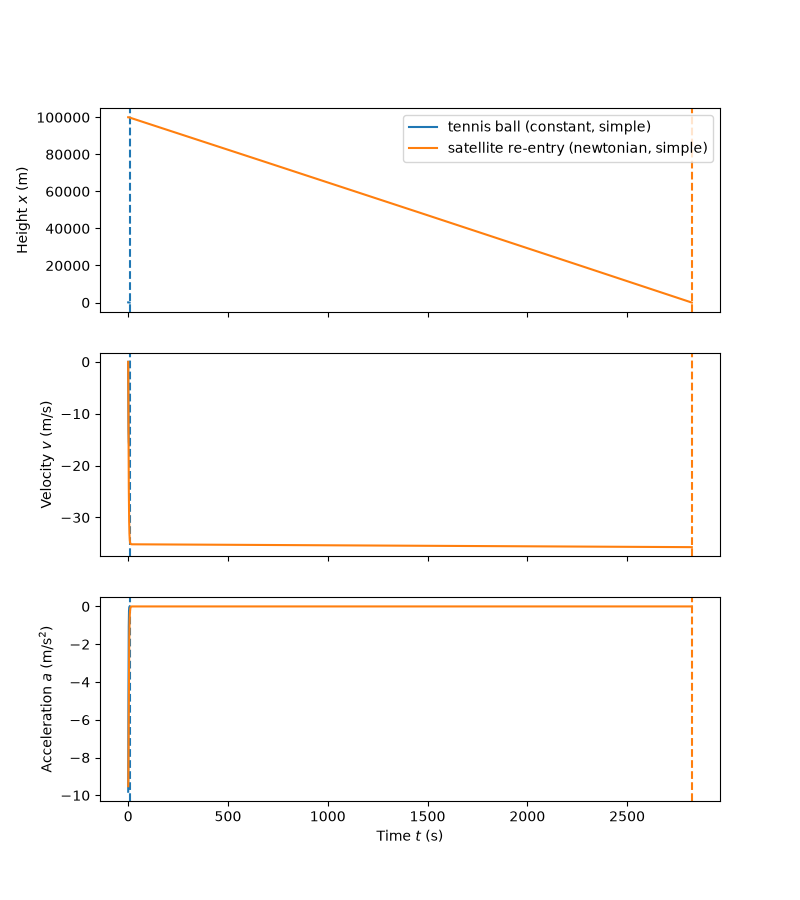

# Ball drop simulation

This program simulates a ball that falls in one dimension under gravity and quadratic drag.
It answers the TOYOTA Racing coding challenge for a Simulation Engineer.
It needs Python 3.10 or newer, numpy and matplotlib.



The plot overlays the two shipped presets.
The satellite falls at 35 to 36 m/s for most of its 2824 s run, so its height curve is almost a straight line.
On these shared axes the tennis ball run (100 m, about 7 s) is almost invisible near t = 0. Run it alone to see its curves.

## Quick start

One command sets up a virtual environment, installs the requirements, runs all tests and opens the GUI.

```
./start.sh          # Linux and macOS
start.bat           # Windows
python3 start.py    # any system (python start.py on Windows)
```

Options: `--no-gui` sets up and tests only. `--no-tests` skips the test run.

If `./start.sh` reports "permission denied", your unzip tool dropped the executable bit. Run `sh start.sh` or `python3 start.py` instead.

The script uses the interpreter inside `.venv` itself, so you do not need to activate the environment.
To work by hand, run these commands once:

```
python -m venv .venv
source .venv/bin/activate        # Windows: .venv\Scripts\activate
pip install -r requirements.txt
```

On Debian and Ubuntu, `python -m venv` can need the `python3-venv` package. The GUI needs Tk.
`requirements.txt` sets only a minimum version for pytest.

## Layout

Paths are relative to this folder.

* `ballsim/parameters.py`: `Ball`, `State`, `Parameters`, `validate`, and the name lists `GRAVITY_MODELS` and `INTEGRATOR_NAMES`.
* `ballsim/forces.py`: `Force` and its subclasses `ConstantGravity`, `NewtonianGravity` and `QuadraticDrag`.
* `ballsim/integrators.py`: `simple_step`, `rk4_step` and the `INTEGRATORS` dictionary.
* `ballsim/simulation.py`: `make_forces`, `acceleration`, `run`, `describe`, `write_csv` and the `Trajectory` class.
* `ballsim/presets.py`: `from_dict`, `load_preset` and `save_preset`.
* `ballsim/plotting.py`: `make_axes` and `add_trajectory`. It uses `Figure` and not pyplot, so the GUI can embed it.
* `ballsim/__main__.py`: the command line and `csv_path`.
* `ballsim/gui.py`: the Tk window.
* `tests/`: the tests.
* `presets/`: the tennis ball and satellite re-entry presets.
* `start.py`, `start.sh`, `start.bat`: the one-command setup. It checks Python and Tk, builds `.venv`, installs, tests and starts the GUI.

The solution keeps to the core that the brief asks for, plus a small GUI to run it, and stops there.
The next steps are in "Limitations" and in "How I would extend or improve the simulation".

## What the brief asks and where it is met

Test names are in `tests/`.

| Brief requirement | Where in the code | Test that proves it |
|:--|:--|:--|
| Drag `\|FD\| = CD rho v^2 pi r^2`, opposite to motion | `forces.py`, `QuadraticDrag` | `test_forces.py::test_drag_opposes_motion`, `test_simulation.py::test_terminal_velocity` |
| Constant gravity `FW = m g` | `forces.py`, `ConstantGravity` | `test_forces.py::test_constant_gravity`, `test_simulation.py::test_free_fall_matches_closed_form` |
| Newtonian gravity `-FW = G M m / (R + x)^2` | `forces.py`, `NewtonianGravity` | `test_simulation.py::test_run_uses_chosen_gravity_model` |
| User picks the gravity model | `Parameters.gravity_model`, `make_forces`, GUI menu | `test_simulation.py::test_run_uses_chosen_gravity_model`, `test_presets.py::test_invalid_field_named` |
| `FW + FD = m a` | `simulation.py`, `acceleration` | `test_simulation.py::test_free_fall_matches_closed_form`, `test_terminal_velocity`, `test_rk4_more_accurate_and_both_converge` |
| Forces at time t from the current x and v, then numerical integration | `run` passes `accel(state)` to the integrator | `test_integrators.py::test_simple_step_matches_brief_formula` |
| The brief scheme, plus a built-in alternative | `integrators.py`, `simple_step` and `rk4_step` | `test_simple_step_matches_brief_formula`, `test_rk4_accurate_on_spring`, `test_simulation.py::test_rk4_more_accurate_and_both_converge` |
| Calculate x, v and a | `Trajectory`, CSV columns `t,x,v,a` (also the GUI Save CSV button), three plot panels | `test_cli.py::test_cli_prints_summary_and_csv`, `test_simulation.py::test_free_fall_matches_closed_form` |
| User varies CD, rho, r, m, g, G, M, R, initial height and velocity, finish time, time step | `Parameters` and `validate`, one preset key and one GUI entry each | `test_presets.py::test_invalid_field_named`, `test_newtonian_needs_positive_planet` |
| Model valid for x > 0, x = 0 is impact, R + x = 0 not handled | `run` stops at the first x <= 0 and interpolates to x = 0. `validate` requires a positive initial height | `test_simulation.py::test_impact_time_interpolated` |
| Tests and visualisations | `ballsim/plotting.py`, `ballsim/gui.py` | 45 tests in total, `test_plotting.py::test_plot_smoke` |
| Easy to extend, easy to change the input format | `Force` base class, `INTEGRATORS`, `make_forces`, `from_dict` | `test_integrators.py::test_names_match_parameters`, `test_presets.py::test_round_trip`, `test_from_dict_parses_entry_texts` |
| Instructions to compile, run and test | This file, `start.py` | `test_cli.py` (the start scripts have no automated test) |
| One zip named with first and last name | `PrashantKumar.zip`, see the last section | None |

No test checks a negative G or M. `validate` rejects them, but only in the Newtonian model.

## Physics

Height x points up. Velocity v points up. A falling ball has negative v.

Drag force, with no one-half factor because the brief defines the law this way:

```
|FD| = CD * rho * v^2 * pi * r^2
FD   = -CD * rho * pi * r^2 * v * |v|     (always opposes v)
```

Weight force, with constant gravity or with Newtonian gravity:

```
FW = -m * g
FW = -G * M * m / (R + x)^2
```

Newton's second law gives the acceleration:

```
FW + FD = m * a
```

The code adds the forces and divides by the mass.
Weight is always negative (downward). Drag has the opposite sign to v, so it slows a fall.
The ground is at x = 0. In the Newtonian model it lies at distance R from the planet centre.

Integrators (set with the `integrator` key in a preset or with `--integrator`):

* `simple` is the scheme from the brief. It uses one acceleration a_{i-1} for both updates:

```
v_i = v_{i-1} + a_{i-1} * dt
x_i = x_{i-1} + v_{i-1} * dt + 0.5 * a_{i-1} * dt^2
```

* `rk4` is classic fourth-order Runge-Kutta. It is more accurate at larger time steps.

A run ends at the first step that takes the height to zero or below.
The program then interpolates linearly between the two samples to find the impact time and velocity.

## Run

Run all commands from this folder, with the environment active.

```
python -m ballsim presets/tennis_ball.json
python -m ballsim presets/tennis_ball.json presets/satellite_reentry.json
python -m ballsim presets/tennis_ball.json --integrator rk4
python -m ballsim presets/tennis_ball.json --csv out.csv --no-plot
python -m ballsim --gui
```

Each run prints one summary line. For the two presets, the output is:

```
tennis ball: impact at t = 7.348 s, v = -16.088 m/s, max speed 16.088 m/s
satellite re-entry: impact at t = 2824.238 s, v = -35.718 m/s, max speed 35.718 m/s
```

A plot window opens unless you give `--no-plot`. With two presets, the window overlays both runs.

Options:

* `--integrator {simple,rk4}` replaces the integrator in every preset.
* `--no-plot` skips the plot window.
* `--csv PATH` writes each trajectory to a CSV file with the columns `t,x,v,a`, to 6 significant figures (`%.6g`). With several runs, the program adds the run name to the file name, for example `out_tennis_ball.csv`.

In the GUI window, edit the parameters, load or save a preset, and press Run.
Each run adds to the plots. Clear them with Clear plots, or untick Keep previous runs.
Save CSV writes the last run to a file with the columns `t,x,v,a`, in the same format as `--csv`.

## Preset format

A preset is a flat JSON file. The keys are the field names of `Parameters` in `ballsim/parameters.py`.
`presets/tennis_ball.json` shows every key.
All values are in SI units: metres, kilograms, seconds.
Missing keys take the default values, which are the tennis ball values. Unknown keys raise an error.
The program checks the values and names the field that is wrong.

## Test

Run this command from the same folder.

```
python -m pytest -q       # 45 tests, about 0.5 s
```

`start.py` runs the same command.

How the tests show that the physics is correct:

* Closed-form free fall: with no drag, x, v and a match `x0 + v0 t - g t^2 / 2` to 1e-6 m for both integrators.
* Terminal velocity: a long drop reaches `sqrt(m g / (CD rho pi r^2))` within 1 %, and the acceleration goes to zero.
* Integrator convergence: against the `tanh` solution for drag and constant gravity, both errors fall when dt halves. rk4 is more accurate at the tested steps (dt 0.1 and 0.05 s). On a spring, 100 rk4 steps match `cos(1)` to 1e-9.

The GUI has no automated test. I tested it by hand.

## How to extend

New gravity model:

1. Add a `Force` subclass in `forces.py`.
2. Add one branch for it in `make_forces` in `simulation.py`.
3. Add its name to `GRAVITY_MODELS` in `parameters.py`.
4. Add the parameters it needs to `Parameters` and `validate`.
5. Add a label with its symbol and unit for each new parameter to `LABELS` in `gui.py`.

New atmosphere: write a drag class that finds the density from a `density(x)` method, and use it in `make_forces` in place of `QuadraticDrag`.

New integrator: write a function with the signature of `simple_step`. Add it to `INTEGRATORS` and add its name to `INTEGRATOR_NAMES`.

New input format: write one reader that parses the file into a dict and calls `from_dict`, as `load_preset` does.
Call it where the program loads a file: `main` in `ballsim/__main__.py` and `App.load` in `ballsim/gui.py`.
Add the new suffix to `JSON_TYPES` in `gui.py`. The run loop takes only `Parameters`, so a new format does not change the simulation.

2-D motion: `State` holds vectors, each force returns a vector, `run` tests the height component, and `Trajectory`, `write_csv` and `plotting` get one column per component.

## Limitations

The brief sets a simple model on purpose. This section lists what that model and my code cannot do.
Each item has a matching answer, with the same bold name, in "How I would extend or improve the simulation".

### Physics limitations of the brief's model

* **Drag without the one-half factor.** The brief law `|FD| = CD rho v^2 pi r^2` has no one-half factor, so its CD is half of the usual `Cd` in `0.5 Cd rho v^2 A`. The tennis preset uses CD 0.5, a usual sphere value, so its drag is twice the real drag. Its terminal velocity `sqrt(m g / (CD rho pi r^2))` is 16.09 m/s against 22.76 m/s with the usual law, and the 100 m drop lasts 7.35 s against 5.99 s (rk4). A user who copies Cd from a textbook gets twice the drag with no warning.
* **Constant fluid density.** One density applies from the start height to the ground. The satellite preset uses sea-level air (1.225 kg/m^3) from 100 km. The exponential model below gives only 9.5e-6 kg/m^3 at 100 km, so the preset has too much drag high up. The body gets to 99 % of its local terminal velocity `sqrt(m g / (CD rho pi r^2))` in about 10 s. It then falls at 35 to 36 m/s and lands after 2824 s at 35.7 m/s. Thus the preset shows terminal velocity on a large scale, not a real re-entry. With `rho = 1.225 exp(-x / 8500)`, the same body peaks at 857 m/s near 54 km and lands at 35.9 m/s (rk4, dt 0.01 s).
* **Constant drag coefficient.** CD is one number for the whole run, with no change for Reynolds number, Mach number or rarefied air. The satellite preset lands at Mach 0.105 (`a = sqrt(1.4 * 287.05 * T)` with T = 288.15 K at sea level). With the exponential density above, the peak of 857 m/s is Mach 2.5 at this speed of sound. At that Mach number, shock waves change the drag. For a water droplet (1000 kg/m^3) of radius 10 micrometres with CD 0.5 in air (1.225 kg/m^3), the brief law gives 0.462 m/s. This speed is 38 times the Stokes value of 0.012 m/s (`2 (rho_p - rho_f) g r^2 / (9 mu)`, mu = 1.81e-5 Pa s). A tennis ball above about 44 m/s reaches Re 2e5 (`Re = rho v d / mu`, mu = 1.81e-5 Pa s). Re 2e5 is the start of the textbook drag crisis of a smooth sphere.
* **Vertical motion only.** The state is one height and one velocity. There is no horizontal motion, lift, Magnus force from spin or crosswind. A real re-entry starts near orbital speed, `sqrt(G M / (R + h))` = 7848 m/s at 100 km. A drop from rest at 100 km misses about 97 % of that energy (kinetic 3.08e7 J/kg against potential 9.67e5 J/kg). `Force.force` also has no time argument, so wind gusts or thrust need a change to every force.
* **No buoyancy and no added mass.** Only weight and drag act. In air, buoyancy on the tennis ball is 0.34 % of its weight (`rho_f V / m`, `V = 4/3 pi r^3`). In water it is 276 %, so a real ball floats, but the model sinks it at 0.563 m/s.
* **Simple gravity models.** Constant g suits short drops: g changes by 0.003 % over the 100 m tennis drop but by 3.1 % over 100 km. The Newtonian model is a point mass that does not turn. It has no centrifugal term (0.034 m/s^2 at the equator, 0.35 % of g), no Coriolis drift and no oblateness. The inputs g = 9.81 m/s^2 and `G M / R^2` = 9.8195 m/s^2 are separate. Thus a change of model changes g by 0.1 % even near the ground, and the tennis impact time by 0.05 %.
* **Rigid sphere of constant mass.** The ball has no spin, deformation, heating or mass loss. In a real re-entry, heating and ablation are the main physics. The satellite preset loses 99.93 % of its start energy to drag (4.831e8 J of 4.834e8 J). In a real re-entry, part of this energy heats the body.
* **Flat ground and no bounce.** The run stops at the first x <= 0. A tennis ball bounces, but the model ends at the impact speed of 16.09 m/s. It has no terrain height.
* **Still air.** Drag uses the ball velocity only. There is no wind, updraft, gust or turbulence. An updraft of 16.09 m/s would hold the tennis ball still, and the model cannot show this.
* **Sphere only, so m, r and CD act as one group.** Without buoyancy, the motion depends only on gravity and the ballistic coefficient `beta = m / (CD pi r^2)`: 32.3 kg/m^2 for the tennis ball and 159.2 kg/m^2 for the satellite. Two bodies with the same beta give the same run, so a fit to data cannot find r or CD alone. A real satellite or capsule is not a sphere.

### Numerical limitations

* **Fixed step with no error control.** Both integrators use the step that the user sets, with no error estimate and no warning. The drag time scale `tau = v_t / g` is 1.64 s for the tennis ball and 0.047 s for the 10 micrometre droplet. At dt 2 s the simple scheme gives an impact speed of 10.21 m/s instead of 16.09 m/s. At dt 5 s rk4 reports an upward "impact" at +965 m/s. The summary line looks normal in both cases.
* **Linear impact interpolation.** The run finds the impact on a straight line between the last two samples. For a 100 m drop in vacuum, the bound on the added impact-time error is `g dt^2 / (8 |v|)`. This bound is 2.8e-6 s at dt 0.01 s and 6.9e-3 s at dt 0.5 s. The measured error at dt 0.5 s is 7.8e-4 s.
* **R + x = 0 not handled.** The brief says not to handle it, and the run stops at the ground. But rk4 trial states inside one step can go below the ground. An example is the satellite preset with R = 1 m, initial height 50 m, initial velocity -100 m/s, rk4 and dt 1 s. Set its fluid density to 1e-5 kg/m^3 and its finish time to 300 s. The speed overflows to inf, inf - inf gives nan, and the run ends airborne with a height of nan. Numpy gives only runtime warnings. With the preset density of 1.225 kg/m^3, the same case reports an impact at t = 0 s at +1.5e36 m/s, with no warning. The radius of the Earth makes this case unreachable in practice.
* **Step cap and memory.** `validate` rejects more than 1e7 steps. `run` stores four float64 arrays sized by the finish time, not by the impact: 32 B per sample, about 320 MB at the cap. If the finish time is too short, the run ends in the air.
* **No energy check per run.** Only the test suite checks accuracy. A user who runs new values gets no indicator of numerical error.

### Many users and software

* **Silent defaults.** A preset that omits a key gets the tennis ball value, with no warning. The satellite preset without `finish_time` gets 10 s and stops in the air at 99.7 km.
* **Implicit units.** All values are bare SI numbers. The satellite preset with `initial_height` 100, meant as 100 km, lands at 5.090 s and 31.780 m/s with no warning.
* **No preset version.** Presets have no version field. A new key or a new default can change or break old presets, and there is no migration path.
* **CSV without context.** The CSV holds only `t,x,v,a`. It has no parameters, units, integrator, time step or code version. Two runs with the same name write to the same file.
* **Booleans read as numbers.** The loader casts with `float()`, so a preset value of `true` or `false` becomes 1 or 0.
* **Unpinned requirements.** `requirements.txt` sets a minimum version for pytest only. A future numpy or matplotlib release can break the code. I tested with numpy 2.5.4 and matplotlib 3.11.2.
* **One platform tested.** I ran the code only on Linux with Python 3.14.7. I did not run `start.bat` on Windows or anything on macOS. `start.py` accepts Python 3.10, which I did not test.
* **No GUI test.** No automated test covers `ballsim/gui.py`. I tested it by hand on Linux.
* **No CI.** The 45 tests run only by hand or through `start.py`. A change can break existing behaviour without notice.

## How I would extend or improve the simulation

The brief asks this question. I would work through the groups below in this order.
Where a bold name matches a limitation above, the item answers it. "How to extend" gives the code recipes.

### Physics fidelity

* **Drag without the one-half factor.** Pick one convention and label it. Add a conventional drag law with the 0.5 factor and keep the brief law under its own name. Tag each preset with `drag_convention`, so old presets keep their results. Show the convention next to CD in the GUI.
* **Constant fluid density.** Add an atmosphere model with a `density(x)` method: constant (the default), exponential `rho0 exp(-x / H)`, and an interpolated table of the US Standard Atmosphere 1976. A preset key selects it, and a missing key means constant, so old presets keep their results. The same model gives the temperature for the speed of sound and the viscosity.
* **Constant drag coefficient.** Make CD a function or table of Re and Mach, found each step from the speed, density, viscosity and speed of sound. Add a linear Stokes drag force `F = -6 pi mu r v` for Re below 1. Warn when a run leaves the valid range of Re, Mach or Knudsen number for the chosen law.
* **Vertical motion only.** Move `State` to 2-D or 3-D vectors, as in the "2-D motion" recipe. Add the time t to `Force.force` now, while there are only three forces. Then add lift and Magnus forces, and initial conditions as a speed and a flight path angle.
* **No buoyancy and no added mass.** Add a buoyancy force `rho_f V g` and an added mass of `0.5 rho_f V` for a sphere. Both are off by default. Warn when the fluid density is above 1 % of the ball density.
* **Simple gravity models.** Set the default g from `G M / R^2`, or warn when the two differ. Add a rotating planet (centrifugal and Coriolis terms, with latitude) and J2 oblateness. Stop and report when an upward speed is above the escape speed `sqrt(2 G M / (R + x))`.
* **Rigid sphere of constant mass.** Add mass, temperature and spin to `State`, so the integrator advances them. Add a stagnation heat flux (Sutton-Graves) and an ablation law `dm/dt = -q A / Q*`. `acceleration` then reads the mass from the state.
* **Flat ground and no bounce.** Make the ground an event with a policy: stop (the default) or bounce with a coefficient of restitution. Add a ground height, and terrain once the state has vectors.
* **Still air.** Add a wind field `w(x, t)` and compute drag from the relative velocity `v - w`. Model turbulence as a random `w(t)` with a seed in the preset, so runs repeat.
* **Sphere only, so m, r and CD act as one group.** Add a body class with a reference area and a CD for each attitude, with the sphere as the default. Print beta in the summary and in the GUI, so users see the group that controls the run.

### Numerics

* **Fixed step with no error control.** Add an adaptive Runge-Kutta 4(5) integrator (Dormand-Prince) to `INTEGRATORS`, and keep the brief scheme as the default. First add a cheap guard: warn when dt is above 0.1 tau, when the speed passes 1.01 v_t, or when the impact velocity is upward. Add an implicit option for stiff cases such as Stokes drag.
* **Linear impact interpolation.** For `simple`, solve the quadratic of the step for the exact crossing. For `rk4`, fit a cubic Hermite curve through x and v at both ends and find its root. A test then checks the vacuum impact against `sqrt(2 h / g)` to 1e-9 s at dt 0.5 s.
* **R + x = 0 not handled.** Check that each new x, v and a is finite, and stop with an error that names the time. Make `NewtonianGravity` raise an error when R + x <= 0.
* **Step cap and memory.** Store output at an interval that is separate from dt. Grow the arrays in chunks, so memory follows the impact time. Add a "run until impact" mode with a maximum time, and stream long runs to CSV.
* **No energy check per run.** Move the energy balance from the animation prototype into the core. Print the residual `(E0 - (KE + PE + W_drag)) / E0` in each summary, warn above 1e-3 and add a CSV column. For the tennis ball with `simple`, the residual is 5.4e-4 at dt 0.01 s and 0.51 at dt 2 s.

### Inputs, outputs and many users

* **Silent defaults.** Make the physical inputs required. Keep defaults only for the time step and the integrator, or print one line for each default that a run uses.
* **Implicit units.** Accept a value with a unit, such as `"100 km"`, in `from_dict` and convert it to SI there. Warn about values that are not plausible, such as a start height above 0.01 R with constant gravity, or a time step above tau. Write the units into saved presets and the CSV header.
* **No preset version.** Add `schema_version` to presets. `load_preset` migrates older versions through a small table of functions, and a missing version means 1.
* **CSV without context.** Write a JSON file next to each CSV with the full parameters, the code version and the date. Add units to the column names, and add a run number when names repeat.
* **Booleans read as numbers.** Reject `true` and `false` in numeric fields before `float()`, with an error that names the field.

### Visualisation and usability

The features below show the physics while a run plays.
I prototyped these on a separate branch of my repository and left them out of this submission to keep it in scope.

* **Animated ball with force arrows.** The ball moves on a height scale. A blue arrow shows drag and a red arrow shows weight, on one scale, so the two arrows match at terminal velocity.
* **Growing graphs.** Height, velocity and acceleration graphs grow with time on fixed axes. A dashed line marks the terminal velocity.
* **Gauges.** Bars show drag, weight and speed as a share of their run maximum. One bar splits the energy into kinetic, potential and lost to drag.
* **Readout with terminal velocity and the energy balance.** A panel shows 13 values at the current time, with the local terminal velocity and the ratio of drag to weight. The energy balance checks the integrator with no reference solution: its maximum relative error is 5.37e-4 for the tennis ball. One module computes these values from the core force classes, so the viewer code holds no physics.
* **Playback controls.** The viewer has pause and resume, restart, a stepped speed slider from x0.25 to x100, a time scrubber, and the space and r keys. Playback follows the wall clock, so a slow redraw does not slow the simulated time.
* **Animate button.** One GUI button animates the current parameters in one window that it reuses. The GUI imports the viewer only when you press the button, so the core runs without it. `python -m extras.animate` gives the same view from the command line.

### Process and tooling

* **No CI.** Run GitHub Actions on each push. A change must pass before merge.
* **One platform tested.** Run the CI jobs on Linux, Windows and macOS with Python 3.10 and the latest Python. Each job runs pytest and `start.py --no-gui`. The Windows job also runs `start.bat --no-gui`.
* **Unpinned requirements.** Keep version ranges in `requirements.txt` and add a constraints file with the tested set (numpy 2.5.4, matplotlib 3.11.2, pytest 9.2.0). Add one CI job on the minimum versions.
* **Regression baselines.** Store the impact time and speed of each preset (7.348 s and 16.088 m/s, 2824.238 s and 35.718 m/s). A test fails when a change moves them beyond a set tolerance. This protects existing users when I add features.
* **Property-based tests.** Generate random valid inputs and check rules that must always hold. Drag opposes motion. With constant g and a small time step, a drop from rest never passes terminal velocity. The energy residual stays small.
* **No GUI test.** Add a headless smoke test under xvfb that fills the fields, runs, and checks the status text and the plot lines.
* **Packaging.** Add a `[project]` section and a `ballsim` script entry to the existing `pyproject.toml`. Then users can install the package with pip and import it in their own scripts.

## How this was built

I read the brief and settled the design in structured question sessions. I made the design decisions in those sessions.
AI coding assistants (Claude Code) wrote the code and the tests from those decisions.
Each change came with its tests. A separate AI reviewer checked each task against the plan before the commit.
An independent AI review panel then reviewed the core. Two sceptical verifiers tested each serious finding, and AI builders corrected the findings that held.
I tested the GUI by hand on Linux. I am responsible for every line, and I expect to walk through it at the interview.

## What this archive contains

I built the archive with this command:

```
git archive --format=zip --prefix=PrashantKumar/ -o PrashantKumar.zip HEAD
```

It holds exactly the version-controlled files. It holds no virtual environment, no caches and no git history.
